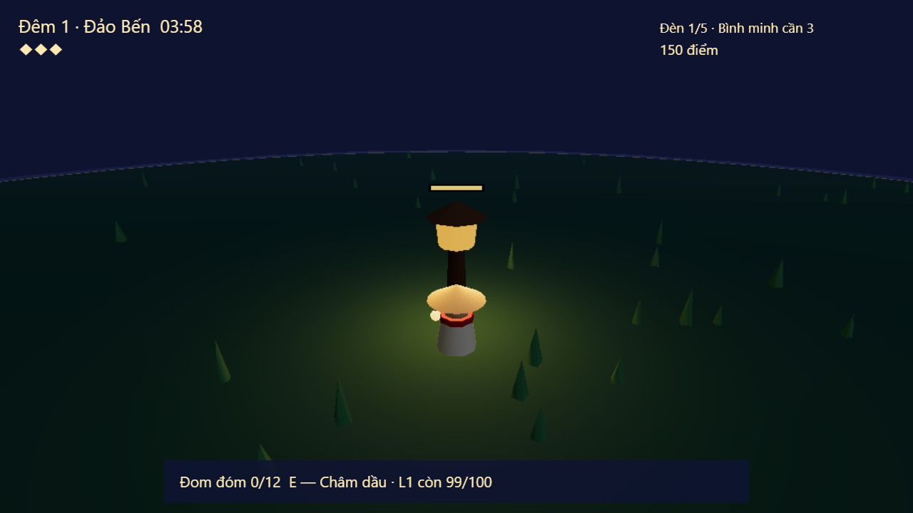

# Day 12 — AI SDLC: Đảo Đèn Lồng

[Video demo Đêm 1](https://github.com/chuanh1214/K5-L3A-DAY12-ChuThiAnh-2A202603360-AI-SDLC-Dao-Den-Long/releases/download/v1.0.0/demo.mp4)

Game 3D góc nhìn thứ ba. Giúp Mây giữ ba hòn đảo sáng tới bình minh.



## Chơi — Ba hòn đảo

Cần Node.js 22, npm và trình duyệt hỗ trợ WebGL 2. Trong thư mục repo, chạy:

```sh
npm ci
npm start
```

Mở http://127.0.0.1:4173, chọn một Đêm đã mở khóa trong danh sách rồi bắt đầu. Đêm tiếp theo được mở khi thắng Đêm trước; tiến trình mở khóa được lưu trên thiết bị. Điều khiển: **WASD** di chuyển, **←/→** hoặc chuột để xoay camera, **Space** nhảy, **Shift** lướt, **E** nạp đèn, **Q** Tỏa Sáng, **Esc/P** tạm dừng. Nhấn chuột vào cảnh để khóa chuột; cài đặt âm lượng và độ nhạy được lưu trên thiết bị.

Để kiểm tra tạm thời cả ba bản đồ mà không đổi tiến trình đã lưu, mở `http://127.0.0.1:4173/?testAllNights=1`.

Để thắng, Mây phải còn Ngọn Lửa khi bình minh lên và giữ đủ đèn sáng. Đảo Bến cần **3/5** đèn sau 240 giây, Đảo Cau cần **4/6** sau 270 giây, Đảo Chuông cần **5/7** sau 300 giây.

Đèn cần 10 đom đóm để thắp lần đầu và 5 để thắp lại. Đèn mất 1 dầu/giây và mỗi đom đóm châm thêm 10 dầu, tối đa 100. Dưới 30 dầu, đèn nhấp nháy, mất vùng an toàn và có thể bị Bóng Mực hút dầu. Sức chứa bắt đầu ở 10, tăng 2 mỗi lần thắp và tối đa 20. Có thể bật **Bảng màu dễ phân biệt** trong Cài đặt.

Mỗi đom đóm nạp hoặc châm dầu được 5 điểm. Thắp lần đầu được 100, thắp lại được 40. Tỏa Sáng được 5 điểm mỗi Bóng Mực, hoặc 15 nếu nó đang hút dầu. Khi thắng, mỗi đèn sáng được 50 điểm cộng phần nguyên lượng dầu còn lại, và mỗi Ngọn Lửa còn lại được 50 điểm. Tổng điểm hành trình là tổng điểm các Đêm đã thắng.

### Kiểm chứng và headless

```sh
npm test
node scripts/headless.mjs --seed 42 --night 1 --ticks 480 --out run.jsonl
```

CLI chạy bằng Node.js, không cần trình duyệt. Thêm `--scenario file.json` để dựng tình huống, `--inputs file.json` để điều khiển theo tick và `--snapshot-every N` để chọn chu kỳ snapshot. Contract và tuning nằm ở [game.contract.json](game.contract.json). Xem [bằng chứng Phase 1](docs/phase-1.md), [tiêu chí Phase 2](docs/phase-2.md) và [bước chuẩn bị](docs/checkpoint-0.md).

Phase 4 dùng Test Contract v1.3. Luật chơi và kết quả Phase 3 được ghi trong [docs/phase-3.md](docs/phase-3.md).

```sh
npm test
node scripts/verify-phase1.mjs
node scripts/headless.mjs --seed 42 --night 1 --ticks 14400 --out night1.jsonl
node scripts/headless.mjs --seed 42 --night 2 --ticks 16200 --out night2.jsonl
node scripts/headless.mjs --seed 42 --night 3 --ticks 18000 --out night3.jsonl
```

Mỗi lệnh headless dừng khi Đêm kết thúc hoặc tới số tick tối đa. Test chạy Đêm đầy đủ có giới hạn 30 giây.

### Benchmark, soak và bảng xếp hạng

```sh
node scripts/bench.mjs --seed 42 --duration 30 --out bench.json
node --expose-gc --jitless --max-semi-space-size=1 scripts/soak.mjs --seed 7 --nights 10 --out soak.json
npm start -- --export-leaderboard out.json
```

Benchmark mở Chrome/Chromium trong cửa sổ riêng. Đặt `LANTERN_BROWSER` thành đường dẫn trình duyệt nếu máy dùng vị trí cài đặt riêng. Bản web dùng `requestAnimationFrame`, nên giữ đồng bộ khung hình của trình duyệt và báo `vsync_off: false`. WebGL không cung cấp RSS của toàn bộ tiến trình trình duyệt, nên `peak_mem_mb` là `null`. Tùy chọn `LANTERN_BENCH_HEADLESS=1` dùng SwiftShader để kiểm tra kỹ thuật.

Sau trận thua hoặc khi đến màn Bình Minh, nhập tên gồm 3–12 ký tự ASCII, số hoặc dấu gạch dưới để lưu điểm. Danh sách top 10 nằm trong `.lantern-data/leaderboard.json`. Trong Cài đặt có thể đổi phím, khôi phục mặc định, bật chữ lớn, giảm chuyển động và bảng màu dễ phân biệt.

Bản web đóng gói trong Release chỉ cần Node.js 22. Giải nén, mở thư mục và chạy `node scripts/serve.mjs`, sau đó mở `http://127.0.0.1:4173`.

Kết quả đo, phạm vi đã kiểm chứng và retro nằm trong [docs/phase-4.md](docs/phase-4.md).

### Sáng tạo của tôi

Mây chạy giữa những dải mây trôi quanh đảo. Tỏa Sáng hiện thành vòng ánh vàng và mỗi chiếc đèn được thắp làm tăng ánh sáng môi trường. Các hiệu ứng này nằm trong lớp hiển thị. Bộ test so sánh toàn bộ JSONL của hai lần chạy cùng seed.

---

> **Cá nhân** (1 người / 1 MSSV) · Áp dụng SDLC cùng AI để xây một **game 3D** qua **4 phase**, từ yêu cầu ban đầu tới bản phát hành.
> **Lab board + trợ giảng:** **[Đảo Đèn Lồng Lab](https://claude.ai/artifact/Q1RYyv1dxjUczzCbd2ZnoW)**

---

## Tài liệu của lab

| File | Nội dung |
|---|---|
| [GUIDE.md](GUIDE.md) | Hướng dẫn làm lab: vòng làm việc mỗi phase, harness, kiểm chứng, token |
| [CHECKPOINTS.md](CHECKPOINTS.md) | Các mốc tự kiểm tra từ chuẩn bị đến nộp bài |
| [SUBMISSION.md](SUBMISSION.md) | Đặt tên repo, hạn nộp, tag, Release, video, checklist |
| [RULES.md](RULES.md) | Quy định: AI, trung thực về bằng chứng, bản quyền, bảo mật |
| [RUBRIC.md](RUBRIC.md) | Thang điểm chi tiết |

## Lab board

Yêu cầu dự án được phát hành tại **[Đảo Đèn Lồng Lab](https://claude.ai/artifact/Q1RYyv1dxjUczzCbd2ZnoW)**. Mỗi phase là một tab (tab chưa phát hành bị khóa), mỗi tab có trợ giảng AI riêng chỉ trả lời trong phạm vi phase đó. Trợ giảng cần đăng nhập claude.ai và dùng lượt Claude của bạn.

## Dự án

**Đảo Đèn Lồng**: game 3D góc nhìn thứ ba. Mây, người giữ đèn nhỏ tuổi, gom đom đóm để thắp lại các Đèn Lồng Lớn và né Bóng Mực trong sương đen.

- Không ràng buộc công nghệ; chạy được trên macOS hoặc Linux.
- Tuân theo **Test Contract** (chế độ headless) để được chấm tự động và so sánh với nhau.

| Phase | Bạn nhận | Nộp |
|---|---|---|
| 1 | **PRD-0** (mô tả tổng quát) + Test Contract | tag `phase-1` |
| 2 | **Ticket-02**, phát hành khi Phase 1 kết thúc | tag `phase-2` |
| 3 | **Ticket-03**, phát hành khi Phase 2 kết thúc | tag `phase-3` |
| 4 | **Ticket-04**, phát hành khi Phase 3 kết thúc | tag `phase-4` + Release `v1.0.0` |

Yêu cầu sẽ được bổ sung và có thể thay đổi giữa các phase, giống dự án thật.

### Lịch 4 giờ

Bài lab kéo dài **4 giờ**. Phase 1 và 2 khoảng **1 giờ**, Phase 3 khoảng **30 phút**, Phase 4 khoảng **1 giờ 30 phút**. Mỗi phase phát hành đúng mốc giờ. Phase mới xuất hiện trên lab board khi tới mốc.

| Mốc | Sự kiện | Hạn tag |
|---|---|---|
| 0h | Phát hành **Phase 1** (PRD-0), gồm cả phần chuẩn bị | `phase-1` trước mốc 1h |
| 1h | Phát hành **Phase 2** | `phase-2` trước mốc 2h |
| 2h | Phát hành **Phase 3** | `phase-3` trước mốc 2h30 |
| 2h30 | Phát hành **Phase 4** | `phase-4`, Release `v1.0.0` và video trước mốc 4h |
| 4h | Hết giờ lab, chốt bài | |

Hết giờ mỗi phase thì tag và chuyển sang phase tiếp theo, dù phase chưa hoàn hảo. Chỗ chưa xong ghi trung thực trong bằng chứng.

---

## Gợi ý SDLC (cách làm là của bạn)

Mỗi phase là một vòng nhỏ. Công cụ, thứ tự, định dạng tài liệu đều tự do; đây chỉ là gợi ý:

1. **Requirements:** biến yêu cầu thành tiêu chí nghiệm thu kiểm chứng được. Chỗ mơ hồ thì tự giả định và ghi lại.
2. **Plan:** nghĩ cách kiểm chứng **trước** khi để agent viết code.
3. **Build:** để agent viết, bạn điều phối và review.
4. **Verify:** chạy thật, kiểm tra hành vi thật. *Không có bằng chứng thì chưa xong*: "agent bảo chạy rồi" không phải bằng chứng.
5. **Evaluate:** cái gì đạt, AI sai ở đâu, harness (AGENTS.md, skill, hook) cần chỉnh gì.
6. **Release:** gắn tag.

## Ba điều cần nhớ

> Bạn được **tự do sáng tạo thêm** quanh phần lõi (nhân vật mới, kẻ địch mới, cơ chế nhỏ, câu chuyện, hiệu ứng, âm thanh…). Sáng tạo gọn và không phá yêu cầu được tính điểm trong hạng mục F của [RUBRIC](RUBRIC.md); ghi mục "Sáng tạo của tôi" trong README của bạn.

- **Game tốt là game đúng yêu cầu của khách hàng**, không phải game phức tạp hay đẹp nhất. Làm đúng và chứng minh được là đúng trước, trau chuốt sau.
- **Cân nhắc kỹ quota token của bạn.** Đốt nhiều token không làm bài tốt hơn. Ngữ cảnh gọn, kế hoạch rõ, kiểm chứng sớm thường vừa rẻ vừa đúng hơn chạy agent liên tục.
- **Kiểm chứng là phần quan trọng nhất.** Bằng chứng (test, output headless, ảnh, số đo) đáng giá hơn lời mô tả.

---

## Bàn giao cuối cùng

Một **repo GitHub cá nhân, public**, gồm:

1. **Toàn bộ mã nguồn** của game qua 4 phase, tag `phase-1` … `phase-4`, Release `v1.0.0`.
2. **Video demo `.mp4` dưới 5 phút** (đính kèm Release `v1.0.0` hoặc `docs/demo/demo.mp4`, link ở đầu README): chơi thử và cho thấy bằng chứng game chạy đúng.
3. **Bằng chứng kiểm chứng** của từng phase (định dạng tự chọn).
4. **Harness AI đã dùng** (AGENTS.md / CLAUDE.md, skills, hooks, plugins…), giữ nguyên trong repo và lịch sử git.
5. **Ghi chép ngắn:** spec/giả định mỗi phase, nhật ký dùng AI (gồm token/chi phí ước tính), retro.

Không commit API key, token hay `.env`. Gửi link repo theo hướng dẫn của Coach.

## Đánh giá (100 điểm)

| Hạng mục | Điểm |
|---|---|
| Test tự động ẩn (headless, gồm kiểm tra lại phase trước) | 30 |
| Kiểm chứng & bằng chứng của bạn | 20 |
| Quy trình SDLC & harness AI | 15 |
| Evaluation & retro (gồm cách bạn dùng token) | 10 |
| Hiệu năng & ổn định | 10 |
| Chất lượng sản phẩm (đúng yêu cầu, chơi được) | 10 |
| Video demo | 5 |

## Quy định

- Dùng AI thoải mái; không sao chép repo của người khác.
- Bằng chứng phải thật: test luôn đạt hay output sửa tay là vi phạm.
- Nhân vật, bối cảnh là bản gốc của lab; asset bên ngoài chỉ dùng loại CC0/CC-BY/MIT hoặc tự tạo, ghi nguồn trong `CREDITS.md`.
